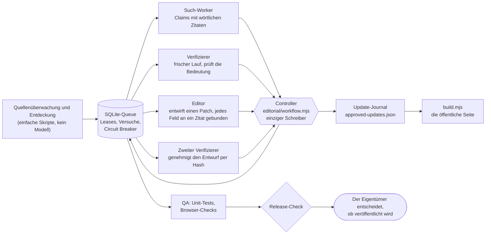

# Minitandem

[](https://github.com/avsomg/minitandem/actions/workflows/test.yml)

English version: [README.md](README.md)

Minitandem ist ein Verzeichnis von Aktivitäten für Familien mit Kindern von 0 bis 6 Jahren im Kanton Freiburg (Schweiz). Es besteht aus einer statischen Web-App (Oberfläche auf Englisch, Deutsch und Französisch; die Katalogtexte werden auf Englisch geschrieben und auf Deutsch und Französisch aus geprüften Übersetzungen gezeigt) und einer redaktionellen Pipeline, die den Katalog laufend überprüft: Modell-Worker mit engen Befugnissen recherchieren und verifizieren Fakten, und nur ein deterministischer Controller mit einer SQLite-Queue darf schreiben.

## In einer Minute

- **Das Produkt:** eine einfache Webseite ohne Framework. Von anderen Servern lädt sie nur die Kartenkacheln des Geoportals des Bundes (`wmts.geo.admin.ch`); Google Maps öffnet sich erst, wenn man eine Wegbeschreibung aufruft. Besucherinnen und Besucher filtern Einträge (im Code `card`) nach Alter, Ort und Kategorie. Favoriten, Notizen und Besuchspläne bleiben im eigenen Browser; ein optionaler kleiner Dienst kann die Daten einer Familie zwischen Geräten abgleichen.
- **Der Gedanke hinter der Pipeline:** Ein Modell darf das Web lesen und Vorschläge machen, aber es schreibt nie. Jede Behauptung braucht ein wörtliches Zitat aus einer Quelle, die der Controller selbst abgeholt hat. Ein zweiter, frischer Lauf beurteilt, ob das Zitat die Behauptung wirklich stützt. Ein Editor entwirft eine Änderung, ein dritter Lauf genehmigt den Entwurf anhand seines Hashes, und erst dann hängt der Controller sie an ein Journal an. Was nicht belegt ist, bleibt «unbekannt».
- **Was ohne Geheimnisse, Netzwerk und Modell läuft:** die Tests, der Build und eine Demo, die zeigt, wie die Pipeline ein falsches Ergebnis zurückweist (`npm run demo`).



Widersprüche zwischen Claims gehen an eine Arbitrate-Rolle, bevor ein Editor sie sieht. Es wird nichts automatisch veröffentlicht.

## Rollen und Modelle

Aus [`editorial/agent-policy.json`](editorial/agent-policy.json). Der Worker-Provider steht auf `claude`; die Claude-Spalte ist also die aktuelle Route. Die frühere Route (OpenAI Codex, bis 8. Oktober 2026 in Gebrauch) steht weiterhin in der Policy und lässt sich weiterhin wählen.

| Rolle | Was sie liefert | Claude-Modell (aktuell) | Effort | Effort bei kritischen Feldern | Frühere Route |
| --- | --- | --- | --- | --- | --- |
| search | Kandidaten, Feld-Claims | `claude-haiku-5-5` | medium | medium | `gpt-6-luna` |
| verify | Belege, Streitfälle, Korrekturen, Claim- und Patch-Urteile | `claude-sonnet-5-5` | low | medium | `gpt-6.1-sol` |
| arbitrate | begründete Entscheide | `claude-opus-5-5` | medium | high | `gpt-6.1-sol` |
| editor | Patch-Entwürfe | `claude-sonnet-5-5` | medium | medium | `gpt-6.1-sol` |
| qa | Testergebnisse | keines (Code) | keiner | keiner | keine |
| release | Release-Manifest | keines (Code) | keiner | keiner | keine |

Ein Worker ist ein einzelner `claude -p`-Lauf mit nur den Werkzeugen Read, WebSearch und WebFetch, in einem temporären Verzeichnis, mit frischem Kontext und einem JSON-Schema für die Antwort. Grenzen: 4 Jobs pro Lauf, 30 Minuten pro Batch, 50 Werkzeugaufrufe pro Job, 15 Minuten Lease, 3 Versuche, bevor ein Job Aufmerksamkeit braucht. Drei Fehler derselben Kategorie bei verschiedenen Einträgen innerhalb einer Stunde öffnen einen Circuit Breaker. Siehe [`editorial/OPERATIONS.md`](editorial/OPERATIONS.md) (englisch) und [`docs/architektur.md`](docs/architektur.md).

## Voraussetzungen

- **Node.js 24.12.0 oder neuer.** Getestet mit 24.12.0; die Version ist in [`.nvmrc`](.nvmrc) festgehalten und wird von der CI verwendet. Die Queue nutzt das eingebaute Modul `node:sqlite`, das eine Warnung über seinen experimentellen Status ausgibt.
- **npm**, um die Abhängigkeiten der Pipeline zu installieren (`editorial/package.json`, festgelegt in `editorial/package-lock.json`: fünf direkte Abhängigkeiten, insgesamt 31 Pakete). Die Seite, die Tests und der Build brauchen nichts weiter.
- **Playwright ist keine deklarierte Abhängigkeit.** Die Browser-Checks (`npm run test:browser`) steuern WebKit über Playwright, und nichts installiert es automatisch. Selbst installieren (`npm install --no-save playwright && npx playwright install webkit`) oder `MINITANDEM_PLAYWRIGHT_DIR` bzw. eine lokale Datei `.playwright-path` auf einen Ordner zeigen lassen, der es enthält ([`playwright-loader.mjs`](playwright-loader.mjs)). Ohne Playwright laufen Unit-Tests, Build und Demo trotzdem.

## Ausführen

```
npm run setup          # npm ci in editorial/ (einmalig nötig)
npm test               # baut die Seite und führt danach alle Tests aus, die auf einem sauberen Klon laufen
npm run demo           # die Pipeline weist ein falsches Ergebnis zurück, offline, in etwa einer Sekunde
npm run build          # die Seite nach .publish/
npm run test:browser   # Alters- und Mobile-Checks in WebKit; braucht Playwright, siehe oben
npm start              # der kleine Dienst auf http://127.0.0.1:8787 (Familienabgleich, Korrekturen)
npm run audit:public   # keine kyrillischen Zeichen, kein früherer Arbeitstitel, keine persönliche Formulierung, keine privaten Kontakte; braucht eine gebaute Seite (npm run build)
npm run scan:public    # Geheimnisse, persönliche Pfade, Kontaktdaten ausserhalb des Katalogs
```

**Die Demo.** `npm run demo` lässt drei erfundene Übungseinträge durch den echten Controller-Code laufen, mit einer temporären Queue: Ein Such-Worker zieht Claims mit wörtlichen Zitaten aus einer abgeholten Seite; der Verifizierer weist einen Claim zurück, dessen Zitat ihn nicht stützt; der Controller lehnt einen Entwurf ab, der auf diesem Claim aufbaut; ein korrigierter Entwurf wird genehmigt und angewendet; die redaktionellen Release-Gates sind bestanden. Das Web und die Modelle sind durch aufgezeichnete Antworten ersetzt: Die Seite ist eine gespeicherte Datei, und die Worker-Antworten sind von Hand geschriebene Fixtures, die dem Worker-Vertrag folgen. Kein Modell hat sie erzeugt. Die QA-Stufe des Release-Checks wird eingereiht, aber nicht ausgeführt. Nichts berührt das Netzwerk oder die echte Queue.

**Tests auf einem sauberen Klon.** `npm test` braucht keinen privaten Zustand, kein Netzwerk und kein Modell. Einige Tests prüfen den Katalog gegen die privaten Recherche- und Übersetzungsdaten des Eigentümers; auf einem sauberen Klon werden sie übersprungen, mit einer Meldung, die mit `private-only:` beginnt. Es sind:

1. `catalog.test.mjs`: follow-up status decisions cover all sixteen new venues without implying age suitability
2. `catalog.test.mjs`: visitor research covers sixteen venues and preserves provenance for nine enrichments
3. `editorial/corrections.test.mjs`: all thirteen October 2 corrections match the compiled catalogue, not just their status
4. `editorial/corrections.test.mjs`: address fixes keep the original identity source of their external review receipt
5. `editorial/external-pipeline.test.mjs`: the real receipts reconcile with the current published catalogue
6. `editorial/external-review.test.mjs`: every published card enters the external evidence queue without fabricated completion
7. `catalogue-i18n.test.mjs`: the unit and the digest are those of the translation records for every card in both languages

Wo sich eine Prüfung aufteilen liess, bleibt der Teil, der nur versionierte Daten braucht, in der Suite für saubere Klone (zum Beispiel: Jeder aktuelle Eintrag ist bereits von der versionierten External-Review-Baseline gedeckt, ein Build braucht also keine Belege). Auf einem sauberen Klon läuft der Build mit `--public`: Die Publikations-Gates brauchen die privaten Belege, werden daher übersprungen, und die Ausgabe des Builds sagt `publicationGates: skipped`. Im Arbeitsordner des Eigentümers führt derselbe Befehl sie weiterhin aus.

## Was bewusst nicht im Repository liegt

Die vollständige Liste mit Grössen und Begründungen steht in [`docs/publication-scope.md`](docs/publication-scope.md) (englisch). Kurz:

- die Job-Queue und alles, was die Worker erzeugt haben: Artefakte, abgeholte Quelltexte, Such-Kandidaten, Streitfälle, Entscheide, externe Review-Belege, eingereichte Korrekturen;
- generierte Momentaufnahmen dieses Zustands (Reports) und datierte Arbeitspapiere des ersten Rollouts;
- das russische Archiv der ersten Projektphase;
- die Vercel-Kontoidentität des Releases (`editorial/release-identity.json`; ein Beispiel mit Platzhaltern ist versioniert), lokale Maschineneinstellungen und Schlüssel;
- die Daten eines laufenden Dienstes (`server-state/`).

## Betrieb

Die Seite läuft seit dem 14. Oktober 2026 unter https://minitandem.ch auf einem kleinen Server (1 vCPU, 2 GB). Eingerichtet ist sie mit diesem `Dockerfile` und dieser `compose.yaml`: die Seite und der Dienst hinter Caddy mit automatischem HTTPS für `minitandem.ch` und `www.minitandem.ch`, der Zustand auf einem benannten Volume, kein Editor-Schlüssel, eine Demo-Familie. Der Zustand wird jede Nacht archiviert (`ops/backup.sh`); eine Wiederherstellung aus einem solchen Archiv wurde am 14. Oktober 2026 geübt.

Die Release-Stufe der Redaktion (`editorial/release.mjs publish`) veröffentlicht einen geprüften Build weiterhin in einem Vercel-Projekt; so wurde die frühere russische Version der Seite veröffentlicht. Für Minitandem wurde sie nicht benutzt. Die Umstellung dieser Stufe auf den oben beschriebenen Server steht noch aus; deshalb gehört `vercel.json` noch zum Build. Der Betrieb ist in [`docs/betrieb.md`](docs/betrieb.md) beschrieben.

## Wie das gebaut wurde

Minitandem entstand, indem Coding-Agenten angeleitet wurden. OpenAI Codex hat den Code bis zum 8. Oktober 2026 geschrieben, seither Claude Code. Der Eigentümer legt die Regeln fest, entscheidet, was veröffentlicht wird, und prüft die Ergebnisse über Tests und Abläufe. Er schreibt den Code nicht selbst, und dieses Repository tut nicht so, als wäre es anders.

Die Geschichte dieses Repositorys beginnt mit seinem ersten Commit. Die Arbeit davor fand in einem privaten Projekt statt, das nicht Teil dieser Geschichte ist. Eine interne Kennung in `editorial/project-id.mjs` trägt noch den Wert eines früheren Arbeitstitels; sie zu ändern würde gespeicherten Zustand ungültig machen. Deshalb bleibt sie bestehen und ist im Audit ausgenommen.

## Was dieses Repository nicht belegt

Es belegt weder, wie viele Personen die Seite nutzen, noch wie viel Traffic sie hat, noch wie genau oder wie vollständig der Katalog ist. Jeder Eintrag zeigt, wann er geprüft wurde und was noch unbestätigt ist; die Abdeckungszahlen in `editorial/canton-coverage.generated.json` sagen, was durchsucht wurde, nicht dass eine Suche vollständig wäre. Seit dem 14. Oktober 2026 führt der Katalog nur Kontakte von Organisationen auf: keine Handynummern, keine Privatpersonen. Ein Eintrag ohne Kontakt verweist auf seine Quellen (siehe `docs/publication-scope.md`).

## Aufbau

- Katalog: `data.js` ist die Basis; `data-reviewed.js` (genehmigte Updates, generiert), `data-practical.js` (Register der Orte), `data-geo.js` (Adresspunkte, generiert) und `regions.js` liegen darüber. `data-de.js` und `data-fr.js` enthalten die deutschen und französischen Katalogtexte: pro Eintrag den Digest des englischen Textes, aus dem übersetzt wurde, und die übersetzten Texte (generiert mit `node scripts/compile-catalogue-i18n.mjs` aus den privaten, geprüften Übersetzungsdaten). Die App lädt nur die Datei der gewählten Sprache; ein Eintrag, dessen englischer Text sich nach der Übersetzung geändert hat, etwa durch ein genehmigtes Update, erscheint auf Englisch, bis er neu übersetzt ist, und der Build meldet, wie viele Einträge das betrifft. `data-towns.js` enthält je Ort einen Mittelpunkt für die Entfernungen in Luftlinie und «Nächste zuerst» (generiert mit `node scripts/compile-towns.mjs` aus dem Geoportal des Bundes; braucht das Netz). Aktuelle Zahlen stehen in der generierten `editorial/profile.json`; die Abdeckung nach Gemeinde in `editorial/canton-coverage.generated.json`. Hier wird keine Gesamtzahl wiederholt, damit sie nicht veralten kann.
- Oberfläche (einfache Skripte, kein Framework; nur die Kartenkacheln kommen von aussen): `index.html`, `styles.css` und eine Datei pro Aufgabe. `i18n.js` mit `strings-en.js`, `strings-de.js`, `strings-fr.js`; `catalogue.js` (Filter, Suche, Sortierung); `catalogue-i18n.js` (deutsche und französische Katalogtexte über den englischen Einträgen); `store.js` und `storage-migration.js` (die eigenen Daten der Besucher im Browser); `sync.js` (optionaler Abgleich mit dem Dienst); `exports.js`; `planning.js` und `exchange.js`; `format.js`, `views.js`, `toast.js`, `map.js` (wird geladen, wenn die Karte geöffnet wird) und `app.js`. `ui-files.mjs` listet sie auf; `sw.js` ist der Service Worker.
- Build: `node build.mjs` schreibt die Seite nach `.publish/` (Seite, Skripte, pro Eintrag eine einfache Seite unter `places/`, vorerst nur auf Englisch, `sitemap.xml`, `research.md`). `site.mjs` hält den öffentlichen Origin.
- Dienst: `server.mjs` ist der kleine Dienst für Familienabgleich, Korrekturen und, auf dem Rechner des Eigentümers, das Editor-Panel (`editorial/admin.html`). `GET /healthz` antwortet ohne Schlüssel.
- Redaktionelle Pipeline: `editorial/`; siehe `editorial/OPERATIONS.md` und `editorial/METHOD.md` (englisch).
- Demo: `demo/`. Container- und Serverdateien: `Dockerfile`, `compose.yaml`, `docker/`, `ops/`. Dokumente: `docs/`.
- Design: `design/minitandem-mockup.html` ist die genehmigte Referenz; `design/app-*.png` sind Bildschirmfotos der echten App (`node screenshots.mjs`).

## Was im Browser bleibt

Favoriten, Notizen, Status, Besuchspläne, das Alter des Kindes, der gespeicherte Startpunkt für Wegbeschreibungen und der für Entfernungen gewählte Ort liegen im Browser der Besucher (Speicherschlüssel `minitandem-…`; Schlüssel der früheren Version verschiebt `storage-migration.js` einmalig). Nichts wird irgendwohin gesendet, solange der Besucher den optionalen Abgleichdienst nicht verbindet. Ein Standort aus dem Ortungsdienst des Browsers («Meinen Standort verwenden») bleibt im Speicher der Seite und wird weder gespeichert noch gesendet.

## Lizenz

Der Code steht unter der MIT-Lizenz (`LICENSE`). Sie gilt nicht für die Katalogdaten: Angaben, Texte und Kontakte zu Angeboten und Anbietern, wo immer sie in diesem Repository stehen (vor allem `data.js`, `data-practical.js`, `data-reviewed.js`, `data-geo.js`, `data-de.js`, `data-fr.js`, `research.md`, die JSON-Dateien unter `editorial/`, die sie enthalten, und Bildschirmfotos der App). Für sie wird keine Lizenz erteilt; sie stammen von den öffentlichen Seiten der Anbieter.

Fremde Dateien in `assets/` behalten ihre eigenen Lizenzen (Leaflet, Leaflet.markercluster, Lucide; die Lizenztexte liegen daneben). Die Fotografie `assets/papiliorama-outside.jpg` ist im Eintrag, der sie zeigt, mit Quelle angegeben (gemeinfrei, Wikimedia Commons).

Kontakt für Korrekturen und Löschbegehren: hello@minitandem.ch
