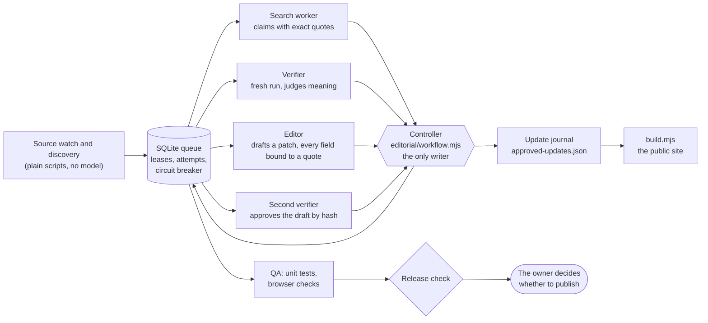

# Minitandem

[](https://github.com/OWNER/minitandem/actions/workflows/test.yml)
<!-- Replace OWNER with the GitHub account name once the repository exists. The workflow runs only after publication. -->

Deutsche Fassung: [README.de.md](README.de.md)

Minitandem is a directory of activities for families with children aged 0 to 6 in canton Fribourg, Switzerland. It is a static web app (interface in English, German and French; the catalogue text is English) plus an editorial pipeline that keeps the catalogue checked: bounded model workers research and verify facts, and a deterministic controller with a SQLite queue is the only part allowed to write.

## In one minute

- **The product:** a plain web page with no framework. Its only requests to other sites are the map tiles of the federal geoportal (`wmts.geo.admin.ch`); Google Maps opens only when a visitor asks for directions. Visitors filter cards by age, place and category. Their favourites, notes and visit plans stay in their own browser; an optional small service can sync a family's records between devices.
- **The idea behind the pipeline:** a model may read the web and propose, but it never writes. Every claim needs an exact quote from a source the controller captured itself. A second, fresh run judges whether the quote really supports the claim. An editor drafts a change, a third run approves the draft by its hash, and only then does the controller append it to a journal. Missing evidence stays unknown.
- **What you can run without any secret, network or model:** the tests, the build, and a demo that shows the pipeline rejecting a wrong result (`npm run demo`).



Disputes between claims go to an arbitrate role before an editor sees them. Nothing is published automatically.

## Roles and models

From [`editorial/agent-policy.json`](editorial/agent-policy.json). The worker provider is set to `claude`, so the Claude column is the current route. The earlier route (OpenAI Codex, used until 8 October 2026) is still in the policy and still selectable.

| Role | What it produces | Claude model (current) | Effort | Effort on critical fields | Earlier route |
| --- | --- | --- | --- | --- | --- |
| search | candidates, field claims | `claude-haiku-5-5` | medium | medium | `gpt-6-luna` |
| verify | receipts, disputes, corrections, claim and patch verdicts | `claude-sonnet-5-5` | low | medium | `gpt-6.1-sol` |
| arbitrate | sourced rulings | `claude-opus-5-5` | medium | high | `gpt-6.1-sol` |
| editor | patch drafts | `claude-sonnet-5-5` | medium | medium | `gpt-6.1-sol` |
| qa | test results | none (code) | none | none | none |
| release | release manifest | none (code) | none | none | none |

A worker is one `claude -p` run with only the Read, WebSearch and WebFetch tools, in a temporary directory, with a fresh context and a JSON schema for the answer. Limits: 4 jobs per run, 30 minutes per batch, 50 tool calls per job, 15-minute leases, 3 attempts before a job needs attention. Three failures of one category on different cards within an hour open a circuit breaker. See [`editorial/OPERATIONS.md`](editorial/OPERATIONS.md) and [`docs/architektur.md`](docs/architektur.md) (German).

## Requirements

- **Node.js 24.12.0 or newer.** Tested with 24.12.0; the version is pinned in [`.nvmrc`](.nvmrc) and used by CI. The queue uses the built-in `node:sqlite` module, which prints an experimental warning.
- **npm**, to install the dependencies of the pipeline (`editorial/package.json`, locked in `editorial/package-lock.json`: five direct dependencies, 31 packages in total). The site, the tests and the build need nothing else.
- **Playwright is not a declared dependency.** The browser checks (`npm run test:browser`) drive WebKit through it, and nothing installs it for you. Install it yourself (`npm install --no-save playwright && npx playwright install webkit`) or point `MINITANDEM_PLAYWRIGHT_DIR` or a local `.playwright-path` file at a folder that has it ([`playwright-loader.mjs`](playwright-loader.mjs)). Without it the unit tests, build and demo still work.

## Run it

```
npm run setup          # npm ci in editorial/ (needed once)
npm test               # builds the site, then runs every test that can run on a clean clone
npm run demo           # the pipeline rejecting a wrong result, offline, in about a second
npm run build          # the site into .publish/
npm run test:browser   # age and mobile checks in WebKit; needs Playwright, see above
npm start              # the small service on http://127.0.0.1:8787 (family sync, corrections)
npm run audit:public   # no Cyrillic, no earlier working title, no personal wording, no private contacts; needs a built site (npm run build)
npm run scan:public    # secrets, personal paths, contact data outside the catalogue
```

**The demo.** `npm run demo` runs three invented training cards through the real controller code with a temporary queue: a search worker extracts claims with exact quotes from a captured page; the verifier rejects one claim whose quote does not support it; the controller refuses a draft that builds on that claim; a corrected draft is approved and applied; the editorial release gates pass. The web and the models are replaced by recorded answers: the page is a saved file, and the worker answers are fixtures written by hand to follow the worker contract. No model produced them. The QA stage of the release check is queued but not run. Nothing touches the network or the real queue.

**Tests on a clean clone.** `npm test` needs no private state, no network and no model. A few tests check the catalogue against the owner's private research records; on a clean clone they are skipped with a message that starts with `private-only:`. They are:

1. `catalog.test.mjs`: follow-up status decisions cover all sixteen new venues without implying age suitability
2. `catalog.test.mjs`: visitor research covers sixteen venues and preserves provenance for nine enrichments
3. `editorial/corrections.test.mjs`: all thirteen October 2 corrections match the compiled catalogue, not just their status
4. `editorial/corrections.test.mjs`: address fixes keep the original identity source of their external review receipt
5. `editorial/external-pipeline.test.mjs`: the real receipts reconcile with the current published catalogue
6. `editorial/external-review.test.mjs`: every published card enters the external evidence queue without fabricated completion

Where a check could be split, the part that needs only tracked data stays in the clean-clone suite (for example: every current card is already covered by the tracked external-review baseline, so a build needs no receipts). The build runs with `--public` on a clean clone: the publication gates need the private receipts, so they are skipped and the build output says `publicationGates: skipped`. In the owner's workspace the same command still runs them.

## What is deliberately not in this repository

The full list, with sizes and reasons, is in [`docs/publication-scope.md`](docs/publication-scope.md). In short:

- the job queue and everything the workers produced: artifacts, captured source texts, search candidates, disputes, decisions, external review receipts, submitted corrections;
- generated snapshots of that state (reports) and dated working papers of the first rollout;
- the Russian archive of the first project phase;
- the Vercel account identity of the release (`editorial/release-identity.json`; an example with placeholders is tracked), local machine settings and keys;
- data of a running service (`server-state/`).

## Deployment

A `Dockerfile` and `compose.yaml` are prepared for a small server: the site and the service behind Caddy with automatic HTTPS for `minitandem.ch` and `www.minitandem.ch`, the state on a named volume, no editor key, one demo family. Nothing has been deployed yet.

The editorial release stage (`editorial/release.mjs publish`) still deploys a tested build to a Vercel project, which is how the earlier Russian version of the site was published; it has not been used for Minitandem. Moving that stage to the server above is open work, so `vercel.json` is still part of the build. Operations are described in German in [`docs/betrieb.md`](docs/betrieb.md).

## How this was built

Minitandem was built by directing coding agents. OpenAI Codex wrote the code until 8 October 2026; Claude Code has done so since then. The owner sets the rules, decides what is published and checks results through tests and process. He does not write the code himself, and this repository does not pretend otherwise.

The history of this repository starts at its first commit. The work before it happened in a private project, which is not part of this history. One internal identifier in `editorial/project-id.mjs` still carries the value of an earlier working title; changing it would make stored state stop validating, so it is kept and exempted in the audit.

## What this repository does not show

It does not show how many people use the site, how much traffic it has, how accurate the catalogue is or how complete. Each card shows when it was checked and what is still unconfirmed; the coverage figures in `editorial/canton-coverage.generated.json` say what has been searched, not that a search is complete. Since 14 October 2026 the catalogue lists organisation contacts only: no mobile numbers, no private persons. A card without a contact points to its sources (see `docs/publication-scope.md`).

## Layout

- Catalogue: `data.js` is the base; `data-reviewed.js` (approved updates, generated), `data-practical.js` (venue registry), `data-geo.js` (address points, generated) and `regions.js` sit on top of it. Current counts are in the generated `editorial/profile.json`; coverage by municipality is in `editorial/canton-coverage.generated.json`. No total is repeated here so that it cannot go stale.
- Interface (plain scripts, no framework; map tiles are the only outside requests): `index.html`, `styles.css`, and one file per concern. `i18n.js` with `strings-en.js`, `strings-de.js`, `strings-fr.js`; `catalogue.js` (filters, search, sorting); `store.js` and `storage-migration.js` (the visitor's own records in the browser); `sync.js` (optional sync with the service); `exports.js`; `planning.js` and `exchange.js`; `format.js`, `views.js`, `toast.js`, `map.js` (loaded when the map is opened) and `app.js`. `ui-files.mjs` lists them; `sw.js` is the service worker.
- Build: `node build.mjs` writes the site to `.publish/` (page, scripts, one plain page per card under `places/`, `sitemap.xml`, `research.md`). `site.mjs` holds the public origin.
- Service: `server.mjs` is the small service for family sync, corrections and, on the owner's machine, the editor panel (`editorial/admin.html`). `GET /healthz` answers without a key.
- Editorial pipeline: `editorial/`; see `editorial/OPERATIONS.md` and `editorial/METHOD.md`.
- Demo: `demo/`. Container and server files: `Dockerfile`, `compose.yaml`, `docker/`, `ops/`. Documents: `docs/`.
- Design: `design/minitandem-mockup.html` is the approved reference; `design/app-*.png` are screenshots of the real app (`node screenshots.mjs`).

## What stays in the browser

Favourites, notes, statuses, visit plans, the child's age and the saved starting point for directions live in the visitor's browser (`minitandem-…` storage keys; keys of the earlier version are moved once by `storage-migration.js`). Nothing is sent anywhere unless the visitor connects the optional family service.

## Licence

The code is under the MIT licence (`LICENSE`). It does not cover the catalogue data: facts, texts and contacts about activities and organisers, wherever they appear in this repository (mainly `data.js`, `data-practical.js`, `data-reviewed.js`, `data-geo.js`, `research.md`, the JSON records under `editorial/` that hold them, and screenshots of the app). No licence is granted for them; they were compiled from the organisers' public pages.

Third-party files in `assets/` keep their own licences (Leaflet, Leaflet.markercluster, Lucide; the licence texts are next to them). The photograph `assets/papiliorama-outside.jpg` is credited on the card that shows it (public domain, Wikimedia Commons).

Contact for corrections and removal requests: hello@minitandem.ch
